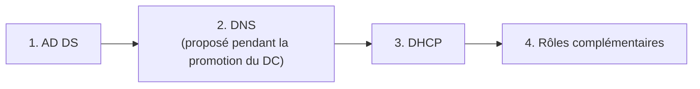

[← Chapitre précédent](02-Installation-et-post-installation.md) · [Sommaire](Readme.md) · [Chapitre suivant →](04-Active-Directory-DNS-et-Kerberos.md)

# Rôles et services

## 🎯 Objectifs du chapitre

- Distinguer rôles et fonctionnalités
- Mesurer l'impact de l'ajout d'un rôle
- Utiliser le gestionnaire de serveur
- Situer les rôles AD DS, DNS, DHCP, serveur de fichiers, d'impression et IIS

---

## 1. Rôles et fonctionnalités

- Un **rôle** est une fonction principale du serveur, qui rend un service au réseau : AD DS pour gérer les identités, DHCP pour distribuer les adresses IP…
- Une **fonctionnalité** est un composant logiciel qui étend les capacités du serveur sans être un service en soi : sauvegarde Windows Server, client Telnet, outils d'administration (RSAT)…

```powershell
Get-WindowsFeature                                       # lister rôles et fonctionnalités
Install-WindowsFeature DHCP -IncludeManagementTools      # installer un rôle et ses consoles
```

### L'impact de l'ajout d'un rôle

Chaque rôle ajoute du code, des services et des ports ouverts. Pour une
infrastructure stable et sûre :

- n'installer que les composants **strictement nécessaires** : moins de problèmes de performance, moins de vulnérabilités ;
- **répartir** les rôles sur plusieurs serveurs quand c'est justifié, pour la charge comme pour la disponibilité.

---

## 2. Le gestionnaire de serveur

Le **gestionnaire de serveur** (*Server Manager*) est la console graphique
centrale d'administration : configuration du serveur, ajout et suppression
de rôles et de fonctionnalités, suivi des performances et des services,
accès aux outils d'administration. Il peut gérer plusieurs serveurs depuis
une même console.

---

## 3. AD DS, DNS et DHCP

Ce sont les trois services fondamentaux d'un environnement Windows Server.

| Service | Indispensable au domaine ? | Rôle |
|---|---|---|
| **AD DS** | oui | gestion centralisée des utilisateurs, groupes, ordinateurs et accès |
| **DNS** | oui | résolution de noms ; AD en dépend entièrement |
| **DHCP** | non | distribution automatique des configurations IP ; peut être assuré par un autre équipement (serveur Linux, routeur) ou remplacé par un adressage statique |

### Ordre d'installation



L'installation du rôle **AD DS** vient en premier : pendant la promotion du
serveur en contrôleur de domaine, l'assistant propose d'installer le rôle
**DNS**, ou de désigner un DNS existant. Vient ensuite **DHCP**, puis les
rôles complémentaires.

### Active Directory

Service de gestion centralisée des utilisateurs, des groupes, des
ordinateurs et des accès. Le **contrôleur de domaine** (DC) :

- détient l'annuaire **LDAP** et y range les objets du domaine, hiérarchiquement, dans des **unités d'organisation** (UO) ;
- **authentifie** utilisateurs et ordinateurs avec le protocole **Kerberos** ;
- applique les **stratégies de groupe** (GPO) définies par les administrateurs ;
- détermine les privilèges et les droits d'accès des utilisateurs.

### DNS

Traduit les noms de domaine en adresses IP, et inversement. Composant
essentiel d'Internet, il est aussi **indispensable à Active Directory**, qui
repose entièrement sur la résolution des noms de ses objets (voir le
[chapitre 04](04-Active-Directory-DNS-et-Kerberos.md)).

### DHCP

Attribue dynamiquement aux clients leur adresse IP et leurs paramètres
réseau : masque, passerelle par défaut, serveurs DNS. Il repose sur
l'échange **DORA** : *Discover*, *Offer*, *Request*, *Acknowledge*.

---

## 4. Rôles complémentaires

| Rôle | Ce qu'il apporte |
|---|---|
| **Serveur de fichiers** | stockage et partage de fichiers dans le domaine ; gestion des autorisations, des quotas, surveillance de l'espace |
| **Serveur d'impression** | gestion centralisée des imprimantes réseau, publication dans Active Directory, quotas, suivi des travaux |
| **Serveur web IIS** | publication de sites, d'applications et de services web. Prend en charge nativement ASP.NET, HTML, CSS, JavaScript, et par modules PHP, Python… ; pools d'applications, HTTPS, supervision des performances |

---

## ✅ Vérifier ses acquis

1. Pourquoi DHCP n'est-il pas indispensable au fonctionnement d'un domaine, contrairement à DNS ?
2. Quel rôle installe-t-on en premier pour créer un domaine ?
3. Pourquoi ne faut-il installer que les rôles nécessaires ?

<details>
<summary>Voir la correction</summary>

1. Les clients peuvent être configurés en adressage statique, ou recevoir leur configuration d'un autre équipement ; en revanche, sans DNS, ils ne savent pas localiser les contrôleurs de domaine.
2. AD DS (avec DNS, proposé pendant la promotion).
3. Chaque rôle ajoute des services et des ports : plus de surface d'attaque, de charge et de mises à jour.

</details>

---

[← Chapitre précédent](02-Installation-et-post-installation.md) · [Sommaire](Readme.md) · [Chapitre suivant →](04-Active-Directory-DNS-et-Kerberos.md)
