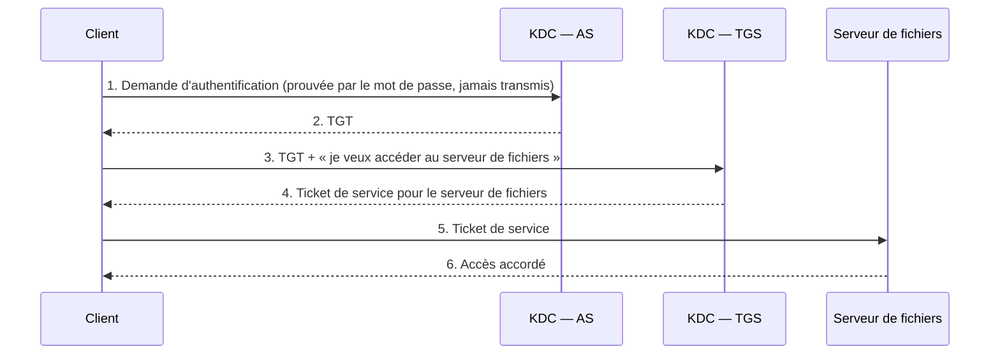

[← Chapitre précédent](03-Roles-et-services.md) · [Sommaire](Readme.md) · [Chapitre suivant →](05-LDAP-et-controleurs-de-domaine.md)

# Active Directory, DNS et Kerberos

## 🎯 Objectifs du chapitre

- Présenter Active Directory et l'intérêt d'un annuaire
- Comprendre la dépendance d'Active Directory envers DNS
- Expliquer l'authentification Kerberos

---

## 1. Présentation

Active Directory s'appelait auparavant **NTDS** (*NT Directory Services*),
du temps de Windows NT. C'est le **service d'annuaire LDAP** de Microsoft,
créé en 1996 et livré avec Windows Server depuis la version 2000.

Son objectif : fournir des services **centralisés d'identification et
d'authentification** à un réseau d'ordinateurs Windows. Il répertorie les
éléments du réseau : comptes utilisateurs, serveurs, postes de travail,
dossiers partagés, imprimantes…

### Ce qu'il centralise

- **les ressources** : postes, imprimantes, scanners, dossiers partagés… ;
- **les utilisateurs** : comptes individuels et groupes, avec leurs droits ;
- **les services** : messagerie, portail collaboratif, GED…

### Intérêts d'un annuaire

| Intérêt | Ce que cela apporte |
|---|---|
| **Administration centralisée** | tous les objets gérés au même endroit, support des stratégies de groupe |
| **Authentification unifiée** | authentifié une fois, l'utilisateur accède aux ressources des autres serveurs du domaine, selon ses autorisations |
| **Identification des objets** | chaque objet est unique, facile à retrouver |
| **Référencement** | une base de données des utilisateurs, groupes et ordinateurs de l'entreprise |

---

## 2. DNS et Active Directory

### Une dépendance totale

Pour rejoindre un domaine ou s'y authentifier, un client doit **localiser un
contrôleur de domaine** : il interroge DNS. Sans DNS fonctionnel, pas
d'Active Directory.

C'est pourquoi l'installation de DNS accompagne généralement la création du
domaine. Le rôle DNS peut toutefois être tenu par le contrôleur de domaine
ou par n'importe quel autre serveur DNS de l'entreprise.

> ⚠️ Ne confondez pas le **domaine Active Directory** (un ensemble d'objets
> administrés ensemble) et le **domaine DNS** (un espace de noms). Ils
> portent souvent le même nom, mais ce sont deux choses distinctes.

### La zone du domaine et ses enregistrements

Les contrôleurs de domaine doivent pouvoir **écrire dans leur zone DNS**
pour y gérer dynamiquement leurs enregistrements. À la création du domaine,
DNS crée une zone dédiée et y enregistre automatiquement tout ce qu'il faut
au fonctionnement d'AD — notamment des enregistrements **SRV** qui
désignent :

- le DC détenteur du rôle FSMO « **émulateur PDC** » ;
- les DC qui hébergent le **catalogue global** ;
- les **KDC** (*Key Distribution Center*) du domaine ;
- tous les contrôleurs du domaine ;

ainsi que :

- la correspondance nom / adresse IP de chaque DC ;
- le **GUID** de chaque DC, pour le localiser dans toute la forêt ;
- les ordinateurs joints au domaine.

```powershell
# Quels contrôleurs de domaine pour entreprise.lan ?
Resolve-DnsName -Type SRV _ldap._tcp.dc._msdcs.entreprise.lan
```

---

## 3. Kerberos

Chaque contrôleur de domaine héberge un **centre de distribution de clés**
(**KDC**), qui fournit deux services.

### AS — Authentication Service

Le service d'authentification délivre un ticket particulier, le **TGT**
(*Ticket-Granting Ticket*) : la preuve que l'utilisateur s'est authentifié.
Le TGT autorise ensuite à demander d'autres tickets au TGS. Il reste valable
jusqu'à son expiration ; au-delà, il faut s'authentifier de nouveau auprès
de l'AS.

### TGS — Ticket-Granting Service

Le service d'émission de tickets délivre les tickets d'accès aux services du
domaine. Pour accéder à un serveur, le client présente son TGT au TGS et
obtient un **ticket de service** propre à ce serveur.



Sans Kerberos, pas d'authentification : si aucun KDC n'est joignable, les
utilisateurs ne peuvent plus ouvrir de session ni accéder aux ressources du
domaine.

### Le contenu d'un ticket

Un ticket Kerberos identifie l'entité à laquelle il est attribué : son nom,
le poste d'origine, sa date d'émission et sa durée de validité. Il ne
contient **jamais le mot de passe** : il est chiffré avec une clé dérivée du
secret du service visé, et transporte une **clé de session** qui chiffre les
échanges suivants entre le client et le service.

> 💡 `klist`, sur un poste du domaine, affiche les tickets Kerberos de la
> session ; `klist purge` les efface.

---

## ✅ Vérifier ses acquis

1. Pourquoi Active Directory ne fonctionne-t-il pas sans DNS ?
2. Quelle est la différence entre un TGT et un ticket de service ?
3. Que se passe-t-il si plus aucun KDC n'est joignable ?

<details>
<summary>Voir la correction</summary>

1. Les clients localisent les contrôleurs de domaine (et leurs services : LDAP, Kerberos, catalogue global) par des requêtes DNS, notamment sur les enregistrements SRV.
2. Le TGT prouve que l'utilisateur s'est authentifié et sert à demander d'autres tickets ; le ticket de service donne accès à un service précis.
3. Plus aucune authentification n'est possible : ouverture de session et accès aux ressources du domaine échouent.

</details>

---

[← Chapitre précédent](03-Roles-et-services.md) · [Sommaire](Readme.md) · [Chapitre suivant →](05-LDAP-et-controleurs-de-domaine.md)
