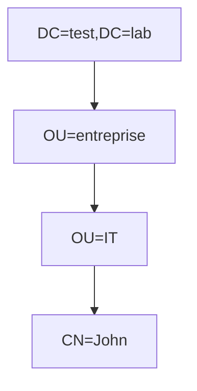
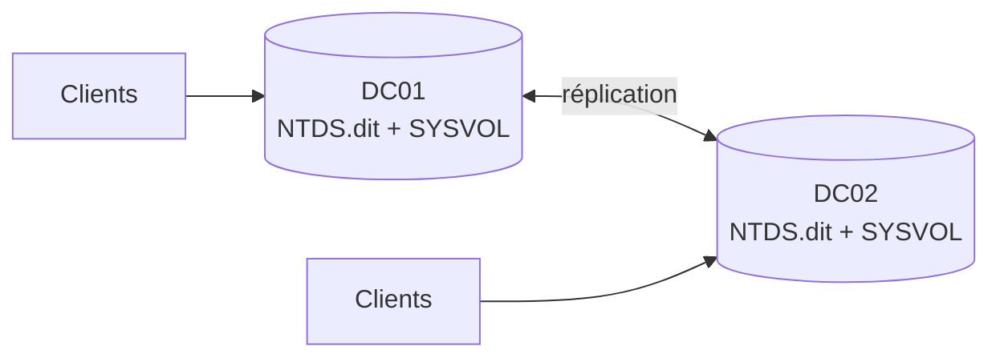

[← Chapitre précédent](04-Active-Directory-DNS-et-Kerberos.md) · [Sommaire](Readme.md) · [Chapitre suivant →](06-Domaines-forets-et-structure.md)

# L'annuaire LDAP et les contrôleurs de domaine

## 🎯 Objectifs du chapitre

- Présenter LDAP et le contenu de l'annuaire
- Identifier un objet par son GUID et son DN
- Connaître les principaux attributs d'un utilisateur
- Comprendre le rôle du contrôleur de domaine et la réplication

---

## 1. LDAP

**LDAP** (*Lightweight Directory Access Protocol*) est un protocole standard
de gestion d'annuaires : il donne accès, par TCP/IP, aux informations sur les
utilisateurs d'un réseau.

| Protocole | Port |
|---|---|
| LDAP | 389/TCP |
| LDAPS (LDAP sur TLS, chiffré) | 636/TCP |
| Catalogue global | 3268/TCP (3269 en TLS) |

### Le contenu de l'annuaire

L'annuaire LDAP de Microsoft, c'est Active Directory. Ses **unités
d'organisation** forment l'arborescence du domaine ; on y trouve des
utilisateurs, ordinateurs, groupes, contrôleurs de domaine, serveurs,
imprimantes, GPO…

Pour chaque classe d'objets et chaque objet, l'annuaire stocke des
**attributs** et leurs valeurs : pour un utilisateur, nom, prénom, login,
description, mot de passe (sous forme de condensat), adresse de messagerie,
téléphone…

---

## 2. Identifier un objet

Un annuaire est un ensemble d'**entrées**, chacune composée d'attributs qui
ont un nom, un type et une ou plusieurs valeurs.

### Le GUID

Chaque entrée porte un identifiant unique, le **GUID** (*Globally Unique
Identifier*), stocké dans l'attribut `objectGUID`. Il est :

- codé sur **128 bits** ;
- **unique** dans la forêt ;
- généré par un algorithme qui garantit cette unicité (données aléatoires et non aléatoires, comme l'heure de création) ;
- attribué à la création de l'objet, et **inchangé** même s'il est déplacé ou renommé.

### Le DN — Distinguished Name

Le **DN** est le **chemin LDAP** complet de l'objet dans l'annuaire, du plus
spécifique au plus général.

Exemple : l'utilisateur « John », dans l'UO « IT », elle-même dans l'UO
« entreprise », du domaine `test.lab` :

```text
CN=John,OU=IT,OU=entreprise,DC=test,DC=lab
```



| Composant | Sens |
|---|---|
| `CN` | *Common Name* : l'objet |
| `OU` | *Organizational Unit* : unité d'organisation |
| `DC` | *Domain Component* : un élément du nom de domaine |

Le DN peut devenir long dans une arborescence profonde, et il **change** dès
que l'objet est déplacé ou qu'une UO parente est renommée — contrairement au
GUID.

### Principaux attributs d'un utilisateur

| Attribut | Description |
|---|---|
| `sAMAccountName` | identifiant de connexion « court » (`jdupont`) |
| `userPrincipalName` | identifiant complet, domaine inclus (`jdupont@test.lab`) |
| `displayName` | nom complet affiché |
| `givenName` | prénom |
| `mail` | adresse de messagerie |
| `description` | description de l'objet |
| `objectSid` | identifiant de sécurité unique (SID) |
| `pwdLastSet` | date du dernier changement de mot de passe |
| `logonCount` | nombre d'ouvertures de session |
| `accountExpires` | date d'expiration du compte (peut être vide) |
| `adminCount` | 1 pour un compte protégé (membre d'un groupe d'administration), 0 sinon |

```powershell
Get-ADUser jdupont -Properties * | Select-Object sAMAccountName, userPrincipalName, DistinguishedName, ObjectGUID, pwdLastSet
```

---

## 3. Le contrôleur de domaine

Un **contrôleur de domaine** (DC) répond aux demandes d'authentification et
contrôle les objets du domaine — utilisateurs, périphériques, services —
pour les organiser, les configurer et les sécuriser.

Le serveur à partir duquel on crée un domaine est **promu** contrôleur de ce
domaine. Il devient le pivot de toutes les requêtes : il vérifie les
identités, traite les authentifications, applique les stratégies de groupe
et stocke une copie de l'annuaire. La création du **premier** DC crée du même
coup le premier domaine, la première forêt et le premier site.

| ✔ Avantages | ✘ Vulnérabilités |
|---|---|
| Gestion centralisée des utilisateurs, postes et serveurs | Cible privilégiée des cyberattaques |
| Gestion centralisée des services | Le réseau dépend de sa disponibilité |
| Partage des fichiers et imprimantes | Exigences matérielles et logicielles |
| Redondance si plusieurs DC | |
| Chiffrement des données utilisateur | |

### Ses fonctions

#### Authentification

Sa mission première : authentifier utilisateurs et postes, et valider leur
accès au réseau.

#### La base de l'annuaire : `NTDS.dit`

Chaque DC détient une copie de la base de l'annuaire, le fichier
**`NTDS.dit`** (par défaut dans `C:\Windows\NTDS`). On peut en créer des
instantanés, pour la consulter hors ligne avec des outils dédiés.

> ⚠️ `NTDS.dit` contient les condensats des mots de passe de tout le domaine :
> c'est le premier fichier que vise un attaquant. Ses sauvegardes doivent
> être protégées comme le DC lui-même.

#### La réplication

Il faut **au moins deux** contrôleurs de domaine, même pour un domaine
unique : la base de l'annuaire est une ressource précieuse, et sa
disponibilité conditionne tout le reste.

- Les DC **répliquent** régulièrement leurs modifications pour maintenir une copie identique de l'annuaire.
- Chaque DC gère des numéros de version (USN) qui lui indiquent s'il est à jour.
- Plusieurs DC se **répartissent** les requêtes des clients.
- Ils répliquent aussi le dossier partagé **SYSVOL**, qui contient les stratégies de groupe et les scripts d'ouverture de session. Jusqu'à Windows Server 2003, cette réplication reposait sur **FRS** (*File Replication Service*) ; depuis Windows Server 2008, sur **DFSR** (*Distributed File System Replication*), plus fiable et plus performant.



```powershell
repadmin /replsummary      # état de la réplication entre DC
```

---

## ✅ Vérifier ses acquis

1. Écrivez le DN de l'ordinateur `PC-042`, dans l'UO `Postes`, elle-même dans l'UO `Lyon`, du domaine `corp.lab`.
2. Pourquoi préférer le GUID au DN pour suivre un objet dans le temps ?
3. Pourquoi deux contrôleurs de domaine au minimum ?

<details>
<summary>Voir la correction</summary>

1. `CN=PC-042,OU=Postes,OU=Lyon,DC=corp,DC=lab`
2. Le GUID ne change jamais ; le DN change dès que l'objet est déplacé ou qu'une UO parente est renommée.
3. Si l'unique DC tombe, plus personne ne s'authentifie et la base de l'annuaire est en danger ; deux DC assurent la continuité et une copie répliquée.

</details>

---

[← Chapitre précédent](04-Active-Directory-DNS-et-Kerberos.md) · [Sommaire](Readme.md) · [Chapitre suivant →](06-Domaines-forets-et-structure.md)
