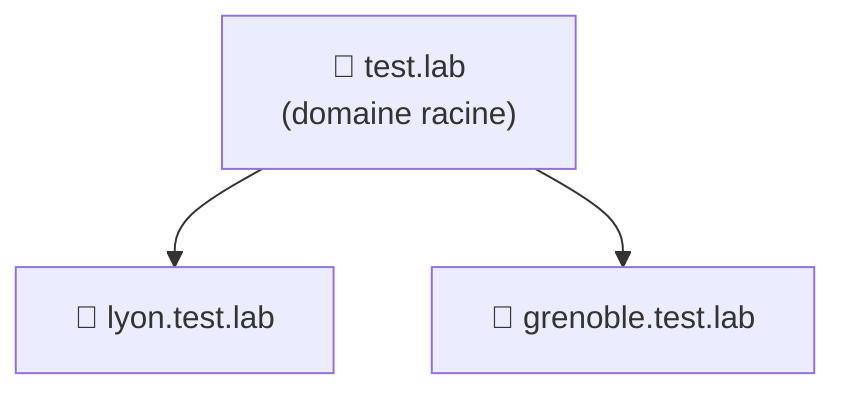
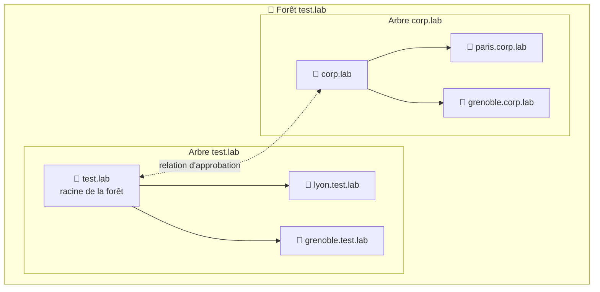

[← Chapitre précédent](05-LDAP-et-controleurs-de-domaine.md) · [Sommaire](Readme.md) · [Chapitre suivant →](07-Utilisateurs-groupes-et-ordinateurs.md)

# Domaines, forêts et structure de l'annuaire

## 🎯 Objectifs du chapitre

- Distinguer domaine, sous-domaine, arbre et forêt
- Comprendre les relations d'approbation et les niveaux fonctionnels
- Connaître les objets, le schéma et les partitions de l'annuaire

---

## 1. Le domaine

Le **domaine** regroupe des unités d'organisation, qui contiennent elles-mêmes
des objets de différentes classes : utilisateurs, ordinateurs, groupes,
contrôleurs de domaine, GPO… On le représente traditionnellement par un
**triangle**.

### Sous-domaines

Une entreprise répartie sur plusieurs sites peut créer, selon l'importance
de ces sites, des **sous-domaines** (domaines enfants) du domaine principal :
`lyon.test.lab`, `grenoble.test.lab`.

### Arbre

Un domaine racine et ses sous-domaines forment un **arbre** : une hiérarchie
de domaines qui partagent un **espace de noms contigu**.



---

## 2. La forêt

Une **forêt** regroupe un ou plusieurs arbres. Notre exemple — un domaine
racine et deux sous-domaines — est une forêt d'un seul arbre. On peut y
ajouter d'autres arbres, qui ne partagent ni le même espace de noms ni la
même structure.



### Intérêts d'une forêt

- tous les domaines partagent un **schéma** commun ;
- tous partagent un **catalogue global** commun ;
- les domaines restent **autonomes**, mais la forêt facilite leurs échanges ;
- les relations entre domaines sont établies **automatiquement** à leur création ;
- l'administration est simplifiée : les utilisateurs d'un domaine peuvent accéder aux ressources d'un autre, avec les autorisations adéquates.

> 💡 La **forêt** est la véritable frontière de sécurité d'Active Directory :
> un administrateur de n'importe quel domaine de la forêt peut, en théorie,
> en compromettre tous les domaines.

---

## 3. Les relations d'approbation

Une **relation d'approbation** (*trust*) est un lien de confiance entre deux
domaines, ou deux forêts : les utilisateurs du domaine **approuvé** peuvent
accéder aux ressources du domaine **approbateur**, selon les autorisations
accordées.

| Caractéristique | Valeurs possibles |
|---|---|
| Sens | **unidirectionnelle** ou **bidirectionnelle** |
| Transitivité | **transitive** (A→B et B→C ⇒ A→C) ou non |
| Création | automatique (entre domaines d'une forêt) ou explicite (entre forêts, avec des domaines externes) |

Au sein d'une forêt, les approbations sont automatiques, bidirectionnelles et
transitives.

---

## 4. Les niveaux fonctionnels

Le **niveau fonctionnel** détermine les fonctionnalités d'Active Directory
disponibles dans un domaine ou une forêt. Il limite ces fonctionnalités pour
rester compatible avec les contrôleurs de domaine les plus anciens.

- Élever le niveau débloque de nouvelles fonctionnalités ; c'est aussi une étape habituelle des migrations, une fois les anciens DC retirés.
- Il est défini **séparément** pour chaque domaine et pour la forêt.
- Le niveau de la forêt ne peut pas dépasser celui du **domaine le plus bas** : on élève d'abord tous les domaines, puis la forêt.
- On ne peut **pas rétrograder** un niveau fonctionnel, sauf rares exceptions (historiquement, de Windows Server 2008 R2 à 2008).

```powershell
Get-ADDomain | Select-Object DomainMode
Get-ADForest | Select-Object ForestMode
```

---

## 5. La structure de l'annuaire

### Les objets

L'annuaire contient différents types d'objets : utilisateurs, ordinateurs,
serveurs, unités d'organisation, groupes… Chaque type correspond à une
**classe**, qui définit ses attributs ; un objet est une **instance** de sa
classe, avec ses propres valeurs.

Certains objets sont des **conteneurs** :

- les **groupes** contiennent des utilisateurs (ou d'autres groupes), pour faciliter la gestion des droits ;
- les **unités d'organisation** classent les objets hiérarchiquement, comme des dossiers, ce qui simplifie l'administration et la délégation.

### Le schéma

Le **schéma** est la liste de toutes les classes et de tous les attributs
que l'annuaire connaît. Il est **extensible** : certaines applications, comme
Microsoft Exchange, l'étendent à leur installation.

> ⚠️ Une modification du schéma est **irréversible** et touche toute la forêt.
> Par défaut, seuls les membres du groupe **Administrateurs du schéma**
> peuvent la faire, et ce groupe doit rester vide en temps normal.

### Les partitions

La base d'Active Directory est divisée en **partitions**, ou *naming
contexts* :

| Partition | Contenu | Unicité |
|---|---|---|
| **Schéma** | définitions des classes et des attributs | une par forêt |
| **Configuration** | topologie de la forêt : domaines, sites, liens entre DC… | une par forêt |
| **Domaine** | objets du domaine : utilisateurs, ordinateurs, groupes… | une par domaine |

---

## ✅ Vérifier ses acquis

1. `paris.corp.lab` et `lyon.test.lab` sont dans la même forêt. Sont-ils dans le même arbre ?
2. Peut-on élever le niveau fonctionnel de la forêt avant celui de ses domaines ?
3. Combien de partitions de domaine compte une forêt de trois domaines ? Et de partitions de schéma ?

<details>
<summary>Voir la correction</summary>

1. Non : ils n'appartiennent pas au même espace de noms contigu (`corp.lab` d'un côté, `test.lab` de l'autre), donc à deux arbres différents.
2. Non : le niveau de la forêt ne peut pas dépasser celui du domaine le plus bas.
3. Trois partitions de domaine, une seule partition de schéma (et une de configuration).

</details>

---

[← Chapitre précédent](05-LDAP-et-controleurs-de-domaine.md) · [Sommaire](Readme.md) · [Chapitre suivant →](07-Utilisateurs-groupes-et-ordinateurs.md)
