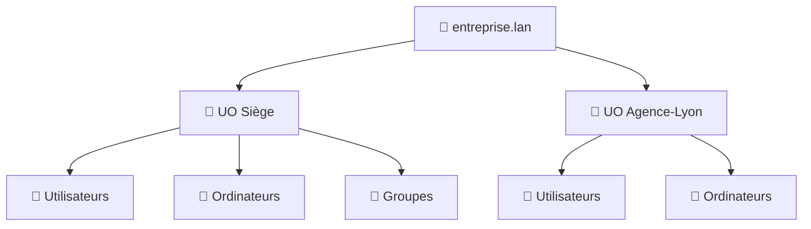

[← Chapitre précédent](06-Domaines-forets-et-structure.md) · [Sommaire](Readme.md) · [Chapitre suivant →](08-Gestion-des-ressources-AGDLP.md)

# Utilisateurs, groupes et ordinateurs

## 🎯 Objectifs du chapitre

- Connaître les outils d'administration d'Active Directory
- Organiser l'annuaire en unités d'organisation
- Créer et gérer des comptes utilisateurs, en console et en PowerShell
- Distinguer les étendues et les types de groupes
- Joindre un ordinateur au domaine

---

## 1. Généralités

- Les **utilisateurs** représentent les personnes autorisées à accéder aux ressources du domaine.
- Les **groupes** rassemblent des utilisateurs qui ont les mêmes besoins d'accès : on attribue les droits au groupe, pas à chaque personne. Changer les droits de quelqu'un revient à l'ajouter à un groupe, ou à l'en retirer.
- Les **ordinateurs** du domaine y sont inscrits : ils bénéficient de l'authentification centralisée, des stratégies de groupe et de l'accès aux ressources partagées.

### Les outils d'administration

| Outil | Usage |
|---|---|
| **Utilisateurs et ordinateurs Active Directory** (`dsa.msc`) | la console historique : créer, modifier, déplacer, supprimer des objets, réinitialiser des mots de passe, déléguer |
| **Centre d'administration Active Directory** (ADAC, `dsac.exe`) | interface plus récente (depuis Windows Server 2008 R2) ; corbeille AD, stratégies de mot de passe affinées, historique PowerShell des actions |
| **Recherche dans Active Directory** | retrouver des objets par filtres : nom, type, attribut… |
| **PowerShell** — module `ActiveDirectory` | automatiser : créations en masse, modifications, rapports |

Ces consoles font partie des **RSAT** (*Remote Server Administration
Tools*), installables sur un poste d'administration : on n'administre pas un
domaine en se connectant au contrôleur.

---

## 2. Les unités d'organisation

Une **unité d'organisation** (UO, ou *OU*) est une subdivision logique de
l'annuaire, qui regroupe des objets similaires — utilisateurs, groupes,
ordinateurs — dans une hiérarchie.

Les UO servent à :

- **déléguer** l'administration d'une partie de l'annuaire à des personnes ou des groupes précis ;
- **appliquer des stratégies de groupe** à un sous-ensemble d'objets ([chapitre 09](09-Strategies-de-groupe.md)).



```powershell
New-ADOrganizationalUnit -Name "Siege" -Path "DC=entreprise,DC=lan"
New-ADOrganizationalUnit -Name "Utilisateurs" -Path "OU=Siege,DC=entreprise,DC=lan"
```

---

## 3. Les utilisateurs

### Créer un utilisateur — console

1. Ouvrir **Utilisateurs et ordinateurs Active Directory**.
2. Naviguer jusqu'à l'UO de destination.
3. Clic droit → **Nouveau** → **Utilisateur**.
4. Renseigner nom, prénom, nom d'ouverture de session, puis le mot de passe et ses options.
5. **Suivant**, puis **Terminer**.

### Créer un utilisateur — PowerShell

```powershell
New-ADUser -Name "Jeanne DUPONT" `
    -GivenName "Jeanne" -Surname "DUPONT" `
    -SamAccountName "jdupont" `
    -UserPrincipalName "jdupont@entreprise.lan" `
    -Path "OU=Utilisateurs,OU=Siege,DC=entreprise,DC=lan" `
    -AccountPassword (Read-Host -AsSecureString "Mot de passe") `
    -ChangePasswordAtLogon $true `
    -Enabled $true
```

> 💡 `Read-Host -AsSecureString` évite d'écrire le mot de passe en clair dans
> le script ou l'historique. Pour un compte de service, on utilise plutôt
> `-PasswordNeverExpires $true` — jamais pour un compte de personne.

### Les modèles de comptes

Un **compte modèle** (désactivé) sert de base à la création d'autres
comptes : clic droit → **Copier**. La copie conserve l'**appartenance aux
groupes** et certains paramètres ; il faut en revanche renseigner :

- prénom, initiales, nom, nom complet ;
- nom d'ouverture de session ;
- mot de passe, et ses options : changement obligatoire à la prochaine ouverture de session, possibilité de le changer, expiration ;
- l'état du compte : activé ou désactivé.

### Activer et désactiver un compte

**Désactiver** un compte bloque l'accès sans le supprimer : les données,
les appartenances et l'historique sont conservés. On désactive un compte :

- au départ, temporaire ou définitif, d'un collaborateur dont il faut conserver les données ou la traçabilité ;
- pendant un changement de poste, pour éviter un accès non autorisé.

```powershell
Disable-ADAccount -Identity jdupont
Enable-ADAccount  -Identity jdupont
```

> 💡 Une bonne pratique : désactiver d'abord, puis supprimer après une
> période de conservation définie (30 ou 90 jours, par exemple).

---

## 4. Les groupes

Un **groupe** rassemble plusieurs objets. Il réduit le nombre d'entrées à
gérer dans les autorisations : quand un utilisateur change de service, on
le change de groupe, sans retoucher les droits du dossier « Comptabilité ».

### Créer un groupe

**Console** : clic droit sur l'UO → **Nouveau** → **Groupe**, puis choisir
le nom, l'**étendue** et le **type**.

**PowerShell** :

```powershell
New-ADGroup -Name "GG-Comptabilite" -GroupScope Global -GroupCategory Security `
    -Path "OU=Groupes,OU=Siege,DC=entreprise,DC=lan"
Add-ADGroupMember -Identity "GG-Comptabilite" -Members jdupont
```

### Les étendues

L'**étendue** d'un groupe définit sa portée dans la forêt, et qui peut en être
membre.

| Étendue | Peut contenir | Utilisable pour donner des droits sur |
|---|---|---|
| **Domaine local** | comptes et groupes de tout domaine approuvé, autres groupes de domaine local du même domaine | les ressources **de son propre domaine** |
| **Globale** | comptes et groupes globaux **de son propre domaine** | les ressources de tout domaine approuvé |
| **Universelle** | comptes, groupes globaux et universels de **toute la forêt** | les ressources de **toute la forêt** ; publiée dans le **catalogue global** |

### Les types

| Type | Usage | SID |
|---|---|---|
| **Sécurité** | attribuer des autorisations d'accès aux ressources | oui |
| **Distribution** | listes de diffusion de messagerie | non |

### Les groupes par défaut

Créés avec la forêt et le domaine, ils sont de trois sortes :

| Sorte | Caractéristiques | Exemples |
|---|---|---|
| **Intégrés** (*Builtin*) | donnent des droits d'administration, généraux ou ciblés ; étendue domaine local ; dans le conteneur `Builtin` | Administrateurs, Opérateurs de sauvegarde, Opérateurs de compte |
| **Spéciaux** (identités spéciales) | gérés exclusivement par le système, qui en calcule les membres | Tout le monde, Utilisateurs authentifiés |
| **Prédéfinis** | complètent les groupes intégrés ; dans le conteneur `Users` | Admins du domaine, Utilisateurs du domaine, Administrateurs du schéma |

---

## 5. Les ordinateurs

Un ordinateur du domaine est représenté par un **objet ordinateur**, créé
lorsqu'on joint la machine (physique ou virtuelle) au domaine, et qui lui
reste lié.

### Joindre un ordinateur au domaine

1. Vérifier la **connectivité réseau** entre le poste et le contrôleur de domaine.
2. Vérifier que le **DNS préféré** du poste est l'adresse d'un DC (ou d'un serveur DNS capable de résoudre le domaine).
3. **Paramètres** → **Système** → **Informations système** → **Domaine ou groupe de travail** (ou `sysdm.cpl`).
4. Onglet **Nom de l'ordinateur** → **Modifier**.
5. Cocher **Domaine** et saisir le nom du domaine (`entreprise.lan`).
6. Saisir les identifiants d'un compte autorisé à joindre des ordinateurs au domaine.
7. Un message de bienvenue confirme la jonction : **OK**.
8. **Redémarrer** pour finaliser.

```powershell
Add-Computer -DomainName "entreprise.lan" -Credential ENTREPRISE\admin `
    -OUPath "OU=Ordinateurs,OU=Siege,DC=entreprise,DC=lan" -Restart
```

> 💡 Sans `-OUPath`, l'objet ordinateur atterrit dans le conteneur
> `Computers`, où aucune GPO d'UO ne s'applique : pensez à le déplacer.

---

## ✅ Exercice

1. Créez l'arborescence d'UO du schéma ci-dessus.
2. Créez, en PowerShell, trois utilisateurs du service comptabilité dans `Siege/Utilisateurs`.
3. Créez le groupe global de sécurité `GG-Comptabilite` et ajoutez-y ces trois utilisateurs.
4. Désactivez l'un des comptes, puis vérifiez son état.
5. Joignez un poste client Windows au domaine, dans `Siege/Ordinateurs`.

<details>
<summary>Voir la correction (étapes 2 à 4)</summary>

```powershell
$ou = "OU=Utilisateurs,OU=Siege,DC=entreprise,DC=lan"
$mdp = Read-Host -AsSecureString "Mot de passe initial"
foreach ($u in "amartin","bleroy","cpetit") {
    New-ADUser -Name $u -SamAccountName $u -UserPrincipalName "$u@entreprise.lan" `
        -Path $ou -AccountPassword $mdp -ChangePasswordAtLogon $true -Enabled $true
}
New-ADGroup -Name "GG-Comptabilite" -GroupScope Global -GroupCategory Security `
    -Path "OU=Groupes,OU=Siege,DC=entreprise,DC=lan"
Add-ADGroupMember -Identity "GG-Comptabilite" -Members amartin,bleroy,cpetit
Disable-ADAccount -Identity cpetit
Get-ADUser cpetit | Select-Object Name, Enabled
```

</details>

---

[← Chapitre précédent](06-Domaines-forets-et-structure.md) · [Sommaire](Readme.md) · [Chapitre suivant →](08-Gestion-des-ressources-AGDLP.md)
