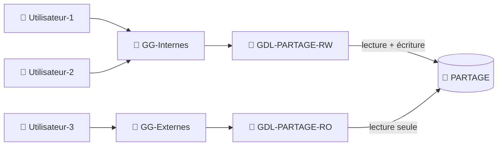
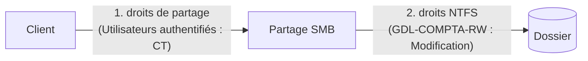

[← Chapitre précédent](07-Utilisateurs-groupes-et-ordinateurs.md) · [Sommaire](Readme.md) · [Chapitre suivant →](09-Strategies-de-groupe.md)

# Gestion des ressources : AGDLP, SMB et NTFS

## 🎯 Objectifs du chapitre

- Appliquer la méthode AGDLP
- Adopter une convention de nommage des groupes
- Partager un dossier en SMB
- Gérer les permissions NTFS

---

## 1. La méthode AGDLP

**AGDLP** — *Account, Global, Domain Local, Permissions* — est la bonne
pratique de gestion des droits d'accès aux ressources partagées :

1. les **comptes** utilisateurs (**A**) sont membres de groupes de sécurité **globaux** (**G**), qui reflètent l'organisation : un service, une fonction ;
2. ces groupes globaux sont membres de groupes de sécurité de **domaine local** (**DL**), qui reflètent un accès à une ressource ;
3. seuls les groupes de domaine local reçoivent les **permissions** (**P**) NTFS sur la ressource.



Pour cet exemple : quatre groupes — deux globaux, deux de domaine local —
puis les globaux placés dans les domaine local correspondant au niveau de
droit souhaité.

### Pourquoi deux niveaux de groupes ?

- **Lisibilité** : les groupes globaux disent *qui* sont les gens, les groupes de domaine local disent *quel accès* ils ont. Sur la ressource, on ne voit que des groupes d'accès explicites.
- **Maintenance** : un nouvel arrivant aux Internes est ajouté à un seul groupe ; un nouvel accès au partage pour les Externes revient à imbriquer un groupe.
- **Multi-domaines** : les groupes de domaine local peuvent accueillir des groupes globaux d'autres domaines approuvés, tout en limitant les droits à leur propre domaine.

Un groupe global peut être membre de plusieurs groupes de domaine local, et
une ressource peut avoir plusieurs groupes de domaine local.

### La convention de nommage

Un nom de groupe doit dire, sans ouvrir ses propriétés, ce qu'il est :

| Partie | Valeurs |
|---|---|
| Type | `GG-` groupe global · `GDL-` groupe de domaine local |
| Ressource | le nom du partage, du dossier : `COMPTA`, `PARTAGE` |
| Droit | `-RO` lecture seule · `-RW` lecture et écriture · `-M` modification · `-CT` contrôle total |

Exemples : `GG-Comptabilite`, `GDL-COMPTA-RW`, `GDL-COMPTA-RO`.

Une fois l'arborescence de groupes en place, il reste à :

1. attribuer les **permissions NTFS** aux groupes de domaine local sur la ressource ;
2. configurer les **autorisations de partage**.

---

## 2. Le partage SMB

Le partage de fichiers Windows repose sur le protocole **SMB** (*Server
Message Block*), qui permet de partager fichiers, imprimantes et autres
ressources sur un réseau. Sa version 3 apporte chiffrement et performances ;
**SMBv1** est obsolète et doit être désactivé.

### Partager un dossier

1. Clic droit sur le dossier → **Propriétés** → onglet **Partage**.
2. **Partage avancé** → cocher **Partager ce dossier**.
3. **Autorisations** : accorder **Contrôle total** à **Utilisateurs authentifiés**.

```powershell
New-SmbShare -Name "COMPTA" -Path "D:\Partages\COMPTA" -FullAccess "Utilisateurs authentifiés"
```

> 💡 Pourquoi un partage aussi ouvert ? Les droits effectifs sont les **plus
> restrictifs** entre partage et NTFS. En ouvrant le partage, on gère tout au
> même endroit : dans NTFS. Deux couches de droits concurrentes sont une
> source garantie d'erreurs.

---

## 3. Les permissions NTFS

Les droits d'accès Windows reposent sur les **ACL** (*Access Control Lists*)
du système de fichiers **NTFS**. Elles définissent, pour chaque utilisateur
ou groupe, ce qu'il peut faire sur un fichier ou un dossier : lire, écrire,
exécuter, modifier, changer les autorisations…

| Permission | Autorise |
|---|---|
| Lecture | afficher le contenu |
| Lecture et exécution | + exécuter les programmes |
| Écriture | créer des fichiers, écrire |
| Modification | lecture, écriture **et suppression** |
| Contrôle total | tout, y compris modifier les autorisations et prendre possession |

### Attribuer des permissions

1. Clic droit sur le dossier → **Propriétés** → onglet **Sécurité**.
2. **Modifier**.
3. Ajouter les groupes de domaine local et leur attribuer les autorisations.



> ⚠️ Les permissions NTFS **s'héritent** du dossier parent. Pour un dossier
> sensible, désactivez l'héritage et retirez les groupes trop larges
> (« Utilisateurs », « Tout le monde ») avant d'ajouter vos groupes.

---

## ✅ Exercice

Le service comptabilité doit pouvoir lire et modifier le dossier
`D:\Partages\COMPTA` ; la direction doit pouvoir le consulter, sans le
modifier.

1. Créez les groupes nécessaires selon AGDLP, avec la convention de nommage.
2. Partagez le dossier.
3. Attribuez les permissions NTFS.
4. Testez avec un compte de chaque service.

<details>
<summary>Voir la correction</summary>

- Groupes globaux : `GG-Comptabilite` (membres : les comptables), `GG-Direction` (membres : la direction).
- Groupes de domaine local : `GDL-COMPTA-M` (membre : `GG-Comptabilite`), `GDL-COMPTA-RO` (membre : `GG-Direction`).
- Partage `COMPTA` : Contrôle total pour Utilisateurs authentifiés.
- NTFS sur `D:\Partages\COMPTA`, héritage désactivé : Administrateurs en contrôle total, `GDL-COMPTA-M` en Modification, `GDL-COMPTA-RO` en Lecture et exécution.

```powershell
New-ADGroup GG-Direction    -GroupScope Global      -GroupCategory Security
New-ADGroup GDL-COMPTA-M    -GroupScope DomainLocal -GroupCategory Security
New-ADGroup GDL-COMPTA-RO   -GroupScope DomainLocal -GroupCategory Security
Add-ADGroupMember GDL-COMPTA-M  -Members GG-Comptabilite
Add-ADGroupMember GDL-COMPTA-RO -Members GG-Direction
New-SmbShare -Name COMPTA -Path D:\Partages\COMPTA -FullAccess "Utilisateurs authentifiés"
```

</details>

---

[← Chapitre précédent](07-Utilisateurs-groupes-et-ordinateurs.md) · [Sommaire](Readme.md) · [Chapitre suivant →](09-Strategies-de-groupe.md)
