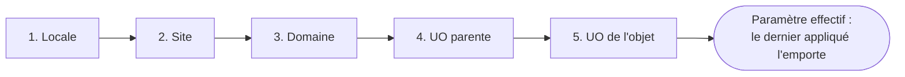

[← Chapitre précédent](08-Gestion-des-ressources-AGDLP.md) · [Sommaire](Readme.md)

# Les stratégies de groupe

## 🎯 Objectifs du chapitre

- Comprendre ce qu'est une GPO et comment elle est stockée
- Distinguer stratégies locales et stratégies de domaine
- Maîtriser l'ordre d'application LSDOU et l'option « Appliqué »
- Forcer et vérifier l'application des GPO

---

## 1. Généralités

Une **stratégie de groupe** (*Group Policy Object*, **GPO**) permet aux
administrateurs de gérer de façon **centralisée** la configuration des
machines et l'environnement des utilisateurs. Les paramètres définis dans
une GPO s'appliquent aux postes, serveurs et utilisateurs ciblés, ce qui
garantit cohérence et sécurité.

Une GPO comporte deux parties : **Configuration ordinateur**, appliquée à la
machine, et **Configuration utilisateur**, appliquée à la session.

### Exemples de paramètres

- définir le fond d'écran ;
- déployer un logiciel ;
- bloquer le panneau de configuration ou l'invite de commande ;
- connecter un lecteur réseau ;
- installer une imprimante ;
- imposer une politique de mots de passe, des règles de pare-feu…

### Le stockage d'une GPO

Pour qu'un client applique une GPO, deux éléments doivent être présents sur
le contrôleur de domaine qui l'a authentifié :

| | **GPC** — *Group Policy Container* | **GPT** — *Group Policy Template* |
|---|---|---|
| Où | dans la base de l'annuaire Active Directory | dans le dossier **SYSVOL** (`\\domaine\SYSVOL\domaine\Policies`) |
| Contenu | les **propriétés** de la GPO (version, état, liens…) | les **fichiers de configuration** de la GPO |
| Identifiant | GUID de la GPO | GUID de la GPO |
| Réplication | réplication de l'annuaire | réplication de SYSVOL (DFSR) |

> 💡 Une GPO qui s'applique sur un DC et pas sur l'autre ? Regardez d'abord
> la réplication : GPC et GPT sont peut-être désynchronisés.

---

## 2. Stratégies locales et de domaine

### Les stratégies locales

Toute machine Windows dispose d'une **stratégie de groupe locale**, éditée
avec la console `gpedit.msc`. Ses paramètres ressemblent à ceux d'une GPO de
domaine, mais restent stockés sur la machine : il faut configurer chaque
poste un par un. Utile hors domaine, ingérable à l'échelle d'un parc.

### Les stratégies de domaine

Les GPO de domaine sont créées dans la **console de gestion des stratégies
de groupe** (**GPMC**, `gpmc.msc`), puis **liées** à un site, au domaine ou à
une UO. Elles appliquent des règles cohérentes à tous les objets visés :
pare-feu, mots de passe, accès aux ressources, chiffrement…

```powershell
New-GPO -Name "U-Fond-ecran" | New-GPLink -Target "OU=Siege,DC=entreprise,DC=lan"
```

---

## 3. L'ordre d'application : LSDOU

Les GPO s'appliquent dans cet ordre :

1. **L**ocale — la stratégie locale de la machine ;
2. **S**ite ;
3. **D**omaine ;
4. **OU** — de l'UO la plus haute à l'UO qui contient l'objet.



### La priorité

Pour un même paramètre, **la dernière GPO appliquée l'emporte** : la plus
proche de l'objet gagne. Une GPO liée à l'UO qui contient l'utilisateur
prime sur une GPO du domaine — sauf si cette dernière est **Appliquée**.

---

## 4. « Appliqué » et « Lien activé »

Deux options du lien d'une GPO, souvent confondues :

| Option | Ce qu'elle fait vraiment |
|---|---|
| **Appliqué** (*Enforced*) | Mauvaise traduction de *enforced* — « imposé ». Force la GPO à l'emporter sur les GPO des niveaux inférieurs, malgré LSDOU : une GPO de domaine imposée s'appliquera même si une GPO d'UO la contredit. Elle ne dit **pas** si la GPO s'applique ou non |
| **Lien activé** | Active ou désactive l'application de la GPO à l'endroit où elle est liée. Décocher l'option suspend la GPO **sans supprimer le lien** |

> ⚠️ « Appliqué » ne s'utilise **jamais par défaut**, seulement en cas de
> nécessité réelle — une politique de sécurité qui ne doit souffrir aucune
> exception, par exemple.

---

## 5. L'application des GPO

### L'actualisation

Par défaut, les GPO s'actualisent en tâche de fond **toutes les 90 minutes**,
avec un décalage aléatoire de **0 à 30 minutes**. En outre :

- certains paramètres **ordinateur** (installation de logiciels, par exemple) ne s'appliquent qu'au **redémarrage** de la machine ;
- certains paramètres **utilisateur** (redirection de dossiers, lecteurs…) ne s'appliquent qu'à la **prochaine ouverture de session**.

### Forcer l'actualisation

**Côté serveur** : dans la GPMC, clic droit sur une UO → **Mise à jour de la
stratégie de groupe** : force l'actualisation à distance sur les ordinateurs
de l'UO.

```powershell
Invoke-GPUpdate -Computer "PC-042" -Force
```

**Côté client** :

```bat
gpupdate /force
```

### Vérifier ce qui est appliqué

En invite de commande **administrateur** :

```bat
gpresult /r                                 :: résumé, ordinateur et utilisateur courant
gpresult /r /user:ENTREPRISE\jdupont        :: pour un utilisateur donné
gpresult /h rapport.html                    :: rapport HTML détaillé
```

Le rapport liste les GPO **appliquées** et celles **refusées**, avec la
raison : filtrage de sécurité, lien désactivé, GPO vide…

---

## ✅ Exercice

1. Créez une GPO `U-Bloquer-CMD` qui interdit l'invite de commande, liée à l'UO `Siege/Utilisateurs`.
2. Créez une GPO `D-Fond-ecran` liée au domaine, qui impose un fond d'écran ; et une GPO `U-Fond-ecran-Siege`, liée à l'UO, qui en impose un autre.
3. Connectez-vous avec un utilisateur du siège : quel fond d'écran voit-il ? Pourquoi ?
4. Passez `D-Fond-ecran` en **Appliqué**. Que se passe-t-il après `gpupdate /force` et une reconnexion ?
5. Vérifiez avec `gpresult`.

<details>
<summary>Voir la correction</summary>

3. Celui de `U-Fond-ecran-Siege` : appliquée après la GPO du domaine (LSDOU), elle l'emporte.
4. Celui de `D-Fond-ecran` : une GPO imposée l'emporte sur les GPO des niveaux inférieurs.
5. `gpresult /r` liste les deux GPO parmi les GPO appliquées ; `gpresult /h rapport.html` montre, pour le paramètre de fond d'écran, la GPO gagnante.

</details>

---

[← Chapitre précédent](08-Gestion-des-ressources-AGDLP.md) · [Sommaire](Readme.md)
